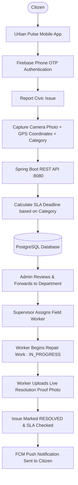

# Urban Pulse

Urban Pulse is an AI-powered smart civic intelligence platform designed to streamline how public infrastructure grievances—such as potholes, overflowing garbage, water pipeline leaks, blocked drainage, broken streetlights, and structural damage—are reported, assigned, tracked, and resolved. It connects citizens directly with municipal administration through a native Android mobile application and web portals, providing real-time transparency and end-to-end accountability.

The platform digitizes the complete civic issue redressal lifecycle: citizens capture live photographs and GPS coordinates using their smartphones, the Spring Boot backend computes dynamic Service Level Agreement (SLA) resolution deadlines and routes tickets to departments, supervisors assign tasks to field workers, and workers upload photographic proof of completed repairs before marking issues resolved.

---

# Software Required

The following software must be installed on your development machine to run the backend and frontend applications:

| Software | Required Version | Purpose |
| :--- | :--- | :--- |
| **Git** | `2.x+` | Clone the source code repositories |
| **Java JDK** | `17 LTS` | Compile and run the Spring Boot 3.3.4 backend |
| **Apache Maven** | `3.8+` | Build backend dependencies and run Spring Boot |
| **PostgreSQL** | `14+` / `15+` / `16+` | Relational database to store users, complaints, and audit history |
| **Node.js** | `>= 22.11.0` (per `package.json`) | JavaScript runtime for React Native and Metro bundler |
| **npm** | `10+` (bundled with Node 22) | Manage frontend packages and dependencies |
| **Android Studio** | Ladybug (`2024.2+`) or newer | Android SDK management, build tools, and emulator |
| **Android SDK Platform** | API `37` (compile), API `36` (target), API `24` (min) | Target platform SDKs defined in `android/build.gradle` |
| **Android SDK Build-Tools** | `37.0.0` | Native Android build compilation defined in `android/build.gradle` |
| **Android SDK Platform-Tools** | Latest (includes `adb`) | Communicate with Android physical phones and emulators |
| **Firebase Project** | Cloud Account | Phone OTP authentication and Firebase Cloud Messaging (FCM) |

---

# How Urban Pulse Works

Urban Pulse connects four user roles—**Citizen**, **Municipal Admin**, **Department Supervisor**, and **Field Worker**—into a single verified workflow:



### Major Workflow Steps

1. **Authentication**: The citizen enters their Indian mobile number, receives a 6-digit SMS OTP from Firebase, verifies it, and the mobile app exchanges the ID token with the Spring Boot backend (`POST /api/auth/login`) to establish a secure session.
2. **Issue Reporting**: The citizen takes an on-site photo using the phone camera, the device captures hardware GPS coordinates (latitude and longitude), and the citizen selects the defect category (`POTHOLE`, `GARBAGE`, `WATER_LEAK`, `DRAINAGE_ISSUE`, `STREET_LIGHT_DAMAGE`, `INFRASTRUCTURE_DAMAGE`).
3. **Backend Persistence & SLA Evaluation**: The image is uploaded to the backend (`POST /api/complaints/upload-image`), the ticket is saved to PostgreSQL in state `SUBMITTED`, and an automatic SLA deadline is set (e.g., 6 hours for water leaks, 12 hours for garbage/drainage, 24 hours for potholes/streetlights, 48 hours for infrastructure).
4. **Administrative Triage**: The Municipal Administrator reviews incoming grievances and forwards each ticket to the responsible department (`PATCH /api/admin/complaints/{id}/forward`).
5. **Supervisor Assignment**: The Department Supervisor reviews their departmental queue and assigns an active field worker to the complaint (`PATCH /api/supervisor/complaints/{id}/assign`).
6. **Worker Repair & Mandatory Photo Proof**: The assigned field worker sets the ticket to `IN_PROGRESS`. After completing the physical repair, the worker captures and uploads a live resolution proof photograph (`POST /api/worker/complaints/{id}/proof`).
7. **Resolution & Citizen Notification**: The ticket is updated to `RESOLVED` (`PATCH /api/worker/complaints/{id}/status`), the system computes whether the issue was resolved within SLA, and an automated Firebase Cloud Messaging (FCM) push notification is delivered to the citizen.

---

# How to Run the Project

### Step 1: Clone the Project
Clone both the backend and frontend repositories into your workspace folder:

```bash
# 1. Clone the Backend
git clone https://github.com/vishnuvardhan1495/Urban-Pulse.git

# 2. Clone the Frontend
git clone https://github.com/vishnuvardhan1495/Urban-Pulse-Citizen-App-Test.git Urban-Pulse-FrontEnd
```

### Step 2: Start Backend
Navigate to the backend directory, ensure PostgreSQL is running with database `urbanpulse`, and start Spring Boot:

```bash
cd Urban-Pulse
mvn clean install -DskipTests
mvn spring-boot:run
```

The backend starts on port **`8080`**. Verify it is running by visiting:
- Health check: `http://localhost:8080/api/test` (Returns `"UrbanPulse Backend is running"`)
- Database check: `http://localhost:8080/api/test/db`

### Step 3: Start Frontend
Open a new terminal, navigate to the frontend directory, install dependencies, and start Metro bundler:

```bash
cd Urban-Pulse-FrontEnd
npm install
npm start
```

### Step 4: Run Android Application
Keep the Metro bundler running. Open another terminal in `Urban-Pulse-FrontEnd`:

```bash
npm run android
```
*(Or use `npx react-native run-android`)*

#### Using a Physical Android Phone (Recommended)
1. On your Android phone, enable **Developer Options** (tap **Build Number** 7 times under *Settings > About Phone*).
2. Enable **USB Debugging** under *Settings > Developer Options*.
3. Connect your phone to your PC with a USB cable and accept the debugging prompt on your phone screen.
4. Verify your phone is recognized:
   ```bash
   adb devices
   ```
   Your device ID should appear with the status `device`.

#### Using an Android Emulator
1. Open Android Studio and launch a Virtual Device (AVD) running API 34, 35, or 36.
2. Running `npm run android` will automatically install and open the app on the running emulator.

### Step 5: Backend URL Configuration
Open `Urban-Pulse-FrontEnd/src/config/api.ts`:

```typescript
export const API_BASE_URL = 'http://192.168.1.100:8080';
```

- **Physical Android Phone**: You **cannot** use `localhost` because on an Android phone, `localhost` points to the phone itself. Replace the IP address with your computer's local Wi-Fi / Ethernet IPv4 address (run `ipconfig` on Windows to find it). Ensure both the phone and PC are connected to the same Wi-Fi network.
- **Android Emulator**: Use `http://10.0.2.2:8080`, which is the special Android emulator alias for the host computer's loopback interface.

---

# Required Configuration

Only the following configuration files and values are required to run Urban Pulse:

### 1. Database Configuration
In `Urban-Pulse/src/main/resources/application.properties`:
- `spring.datasource.url`: `jdbc:postgresql://localhost:5432/urbanpulse`
- `spring.datasource.username`: Your PostgreSQL username (default: `postgres`)
- `spring.datasource.password`: Your PostgreSQL password

> Hibernate automatically creates and updates all database tables on startup (`spring.jpa.hibernate.ddl-auto=update`).

### 2. Firebase Backend Credentials
- Obtain a Firebase Admin SDK Service Account private key JSON from **Firebase Console > Project Settings > Service accounts > Generate new private key**.
- Place the JSON file in `Urban-Pulse/` with the filename `urbanpulse-firebase-admin.json` (referenced by `firebase.credentials.path`).

### 3. Firebase Mobile Configuration
- In Firebase Console, enable **Authentication > Sign-in method > Phone**.
- Register the Android app with package name `com.urbanpulse`.
- Add your debug SHA-1 and SHA-256 fingerprints (obtainable by running `cd android && ./gradlew signingReport`).
- Download `google-services.json` from Firebase and place it in:
  ```text
  Urban-Pulse-FrontEnd/android/app/google-services.json
  ```

### 4. Backend LAN IP Address in Mobile App
- Set `API_BASE_URL` in `Urban-Pulse-FrontEnd/src/config/api.ts` to `http://<YOUR-COMPUTER-IP>:8080`.

---

# Complete Startup Flow

Follow this checklist to start and test the complete system:

1. Install Java 17, Node.js 22+, PostgreSQL, Maven, and Android Studio.
2. Clone `Urban-Pulse` (backend) and `Urban-Pulse-FrontEnd` (frontend).
3. Create the PostgreSQL database `urbanpulse` (`CREATE DATABASE urbanpulse;`).
4. Place `urbanpulse-firebase-admin.json` in the `Urban-Pulse/` folder.
5. Place `google-services.json` in `Urban-Pulse-FrontEnd/android/app/`.
6. Configure `application.properties` with your PostgreSQL password.
7. Install frontend dependencies (`cd Urban-Pulse-FrontEnd && npm install`).
8. Configure your computer's local IP address in `Urban-Pulse-FrontEnd/src/config/api.ts`.
9. Start the Spring Boot backend (`mvn spring-boot:run` in `Urban-Pulse/`).
10. Connect your Android phone (with USB Debugging) or start the Android emulator.
11. Start Metro bundler (`npm start`) and launch the app (`npm run android`).
12. Log in using your phone number and SMS OTP.
13. Snap a photo, capture GPS coordinates, select an issue category, and submit a civic complaint.
