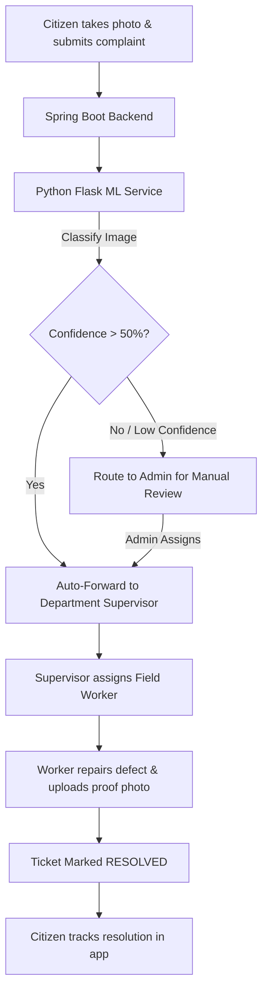

# UrbanPulse

An AI-powered civic issue reporting and management system.

---

## 1. Project Overview

UrbanPulse is a smart civic grievance platform that helps citizens report everyday city problems like potholes, garbage, broken streetlights, and damaged road signs. 

Instead of waiting in long queues or calling municipal offices, citizens take a photo on their phone. UrbanPulse automatically identifies the issue using Artificial Intelligence (AI) and routes it directly to the right municipal department. City staff and supervisors can then review the issue, assign field workers, and resolve it quickly with photo proof.

---

## 2. Features

- **Easy Complaint Registration**: Citizens take a photo and their phone automatically records the exact GPS location.
- **AI-Based Image Classification**: An AI model inspects the photo and predicts what kind of civic issue it is (e.g., Garbage, Pothole, Fallen Tree).
- **Automatic Department Routing**: If the AI is confident (above 50%), the complaint goes straight to that department's supervisor. If not, it goes to the Admin for manual check.
- **Duplicate Detection & Joining**: If someone already reported the same problem within 30 meters, citizens can simply "Join" the issue instead of creating a duplicate ticket.
- **Role-Based Staff Dashboards**:
  - **Admin**: Oversees all complaints, manages departments, and reviews low-confidence issues.
  - **Supervisor**: Reviews department complaints and assigns tasks to workers.
  - **Worker**: Views assigned repair tasks with Google Maps links and uploads proof photos when finished.
- **Live Complaint Tracking**: Citizens can track their complaint status from `SUBMITTED` to `FORWARDED`, `IN_PROGRESS`, and `RESOLVED`.

---

## 3. Technology Stack

- **React Native**: Builds the cross-platform mobile application for citizens.
- **React.js & Vite**: Builds the fast web dashboard for municipality staff, supervisors, and admins.
- **Java & Spring Boot**: The main backend server that handles business logic, security, and REST APIs.
- **PostgreSQL**: The database that stores users, complaints, departments, and history logs.
- **Python & Flask**: Runs the AI/ML microservice that receives images and returns predictions.
- **TensorFlow / Keras**: Powers the MobileNetV2 deep learning model trained on civic issue images.
- **Google Maps**: Provides location links and maps for staff to easily find problem spots.

---

## 4. Project Structure

```text
Urban Pulse/
├── ml-resources/
│   └── CivicComplaintML/
│       ├── models/                 # Pretrained Keras model and class names
│       └── urbanpulse_ai/          # Python Flask ML microservice (Port 5001)
│
├── Urban-Pulse/                    # Java Spring Boot Backend (Port 8080)
│   ├── src/main/java/com/urbanpulse/
│   │   ├── controller/             # REST API endpoints
│   │   ├── service/                # Business logic and ML routing
│   │   ├── repository/             # Database access queries
│   │   └── entity/                 # Database tables (Complaint, User, Department)
│   └── uploads/                    # Folder where uploaded photos are stored
│
├── Urban-Pulse-FrontEnd/           # Frontend projects
│   ├── src/                        # Citizen mobile app screens and services
│   ├── android/                    # Android native app files
│   └── staff-web/                  # Staff React + Vite web dashboard (Port 5173)
│
└── README.md                       # Project documentation
```

### How the Components Talk to Each Other
- The **Citizen Mobile App** sends complaints and images to the **Spring Boot Backend** (`:8080`).
- The **Spring Boot Backend** forwards the image to the **Flask ML Service** (`:5001`) to get the predicted category.
- The **Backend** stores all complaints and users inside the **PostgreSQL Database** (`:5432`).
- The **Staff Web Portal** (`:5173`) talks to the **Spring Boot Backend** to show complaints to admins, supervisors, and workers.

---

## 5. Setup and How to Run

### Software Requirements
Before running the project, install:
- **Java JDK 17**
- **Apache Maven 3.8+**
- **Python 3.10 to 3.13**
- **PostgreSQL 14+** (Version 18 is tested)
- **Node.js (v20 or v22)** and **npm**
- **Android Studio** (for running the mobile app on an emulator or Android phone)

---

### Step-by-Step Startup Guide (Open 5 CMD Windows)

Open separate Command Prompt (`cmd`) windows for each service. Keep all windows running while using the application.

---

#### CMD 1: PostgreSQL Database (Port 5432)
*Open Command Prompt as Administrator.*

1. Start the PostgreSQL Windows service:
   ```cmd
   net start postgresql-x64-18
   ```
2. Verify it is running:
   ```cmd
   sc query postgresql-x64-18
   ```
   *(Status should say `RUNNING`)*
3. Make sure the database named `urbanpulse` exists:
   ```cmd
   psql -U postgres -c "CREATE DATABASE urbanpulse;"
   ```

---

#### CMD 2: Flask ML Service (Port 5001)

1. Go to the project root folder:
   ```cmd
   cd "C:\Users\HP\Urban Pulse"
   ```
2. Run the Flask application:
   ```cmd
   python "ml-resources\CivicComplaintML\urbanpulse_ai\app.py"
   ```
3. **Verify it is running:**  
   Open your browser and visit: `http://localhost:5001/health`  
   You should see: `{"status": "ok", "model_loaded": true, "num_classes": 8}`

---

#### CMD 3: Spring Boot Backend (Port 8080)

1. Go to the backend folder:
   ```cmd
   cd "C:\Users\HP\Urban Pulse\Urban-Pulse"
   ```
2. Start the Spring Boot server:
   ```cmd
   mvn spring-boot:run
   ```
3. **Verify it is running:**  
   Open your browser and visit: `http://localhost:8080/api/test`  
   You should see: `UrbanPulse Backend is running`

---

#### CMD 4: Staff Web Portal (Port 5173)

1. Go to the staff web folder:
   ```cmd
   cd "C:\Users\HP\Urban Pulse\Urban-Pulse-FrontEnd\staff-web"
   ```
2. Install packages (first time only):
   ```cmd
   npm install
   ```
3. Start the Vite server:
   ```cmd
   npm run dev
   ```
4. **Open in browser:**  
   Visit: `http://localhost:5173` to view the Staff Portal login screen.

---

#### CMD 5: Citizen Mobile App (Port 8081)

1. Go to the mobile app folder:
   ```cmd
   cd "C:\Users\HP\Urban Pulse\Urban-Pulse-FrontEnd"
   ```
2. Install packages (first time only):
   ```cmd
   npm install
   ```
3. Set your laptop's local IP address:
   Open `src\config\api.ts` and set your computer's Wi-Fi IP (e.g. `http://192.168.1.50:8080`).  
   *(Do not use `localhost` if testing on a real Android phone).*
4. Start Metro bundler:
   ```cmd
   npm start
   ```
5. In another CMD window, launch the app on your connected Android phone or emulator:
   ```cmd
   cd "C:\Users\HP\Urban Pulse\Urban-Pulse-FrontEnd"
   npx react-native run-android
   ```

---

## 6. How the System Works

Here is the step-by-step journey of a complaint from start to finish:

1. **Citizen Reports Issue**: The citizen opens the mobile app, takes a photo of the defect, and submits it with GPS coordinates.
2. **AI Classification**: The backend sends the image to the Python ML service. The AI model inspects the image and identifies the issue category (e.g., *Potholes and Road Cracks*, *Garbage*, *Damaged Electrical Poles*).
3. **Department Selection**:
   - If AI confidence is **above 50%**, the backend selects the responsible department:
     - *Damaged Concrete Structures* → Engineering Department
     - *Damaged Electrical Poles* → Electrical Department
     - *Damaged Road Signs* → Road Safety Department
     - *Dead Animals Pollution* → Public Health Department
     - *Fallen Trees* → Horticulture Department
     - *Garbage* → Sanitation Department
     - *Illegal Parking* → Traffic Department
     - *Potholes and Road Cracks* → Road Safety Department
   - If AI confidence is **50% or lower**, or the department has no active supervisor, the issue is safely routed to the **Admin** for review.
4. **Supervisor Receives Ticket**: The department supervisor sees the ticket in their web dashboard and assigns a field worker.
5. **Worker Resolves Issue**: The worker travels to the location using Google Maps, repairs the issue, and uploads a photo proof of the completed work.
6. **Citizen Tracks Progress**: The complaint status updates to `RESOLVED`, and the citizen can see the proof photo and completion status on their app.


